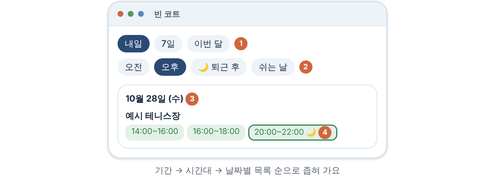
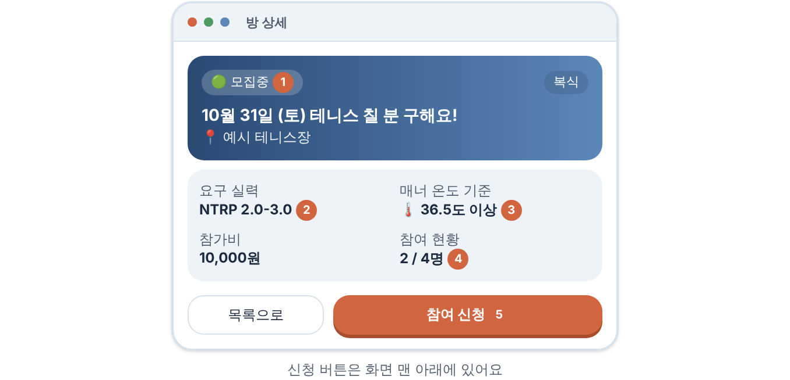

<p align="center"></p>

<h1 align="center">테니스매칭</h1>

<p align="center">부천 테니스장의 빈 시간을 한 화면에서 찾고,<br>같이 칠 사람도 구하는 테니스 매칭 서비스</p>

<p align="center"><a href="https://tennis-matching-mu.vercel.app">서비스</a> · <a href="https://tennis-matching-mu.vercel.app/courts">빈 코트 찾기</a> · <a href="https://tennis-matching-mu.vercel.app/guide">이용 가이드</a></p>

---

## 빈 코트 찾기

이 서비스에서 제일 먼저 만든 기능이고, 가장 많이 쓰라고 만든 기능이에요.

테니스장 예약 사이트는 시설마다 따로 들어가서 날짜를 하나씩 눌러 봐야 빈 시간이 보여요. 그걸 매번 하기가 번거로워서, 부천 지역 테니스장의 예약 가능한 시간을 모아서 날짜별로 보여주게 만들었어요.

<p align="center"></p>

- 기간은 내일, 7일, 이번 달 중에서 골라요.
- 시간대 필터가 있어요. 오전, 오후, 퇴근 후, 쉬는 날. 오전, 오후, 퇴근 후는 하나라도 맞으면 보이고, 쉬는 날은 그중 주말과 공휴일만 남겨요.
- 평일 20시부터 22시는 직장인이 치기 좋은 시간이라 따로 표시해요.
- 매달 25일부터는 다음 달 일정까지 같이 보여줘요. 월말에 이번 달 자리가 거의 없을 때를 생각해서 넣었어요.
- 관심 있는 테니스장을 등록해 두면 예약이 열릴 때 알림을 받을 수 있어요.

주의할 점이 하나 있어요. 이 서비스는 조회 전용이에요. 예약은 각 시설의 예약 사이트에서 직접 해야 하고, 저장해 둔 결과를 보여주는 거라 방금 예약된 자리는 잠깐 남아 보일 수 있어요. 예약하기 전에 한 번 더 확인해 주세요.

수집 방식은 [아래](#빈-코트-수집-방식)에 적어 뒀어요.

## 그 밖의 기능

**매칭.** 방을 만들고 사람을 모아요. 요구 실력과 최소 매너 온도를 정할 수 있고, 방장이 신청을 수락해요. 수락된 사람끼리는 장소 지도와 비공개 채팅을 쓸 수 있어요.

<p align="center"></p>

**평가와 매너 온도.** 경기가 끝나면 같이 친 사람끼리 매너 별점과 상대 실력을 남겨요. 누가 줬는지는 상대에게 안 보여요. 매너 온도는 36.5도에서 시작하고, 별점에 따라 조금씩 오르내려요. 연락 없이 안 나오면 크게 깎여요. 실력 평가가 3번 모이면 검증된 NTRP가 공개돼요.

**레벨, 칭호, 랭킹.** 새싹부터 레전드까지 7단계예요. 경험치만으로는 안 오르고 경기 수와 방문일도 채워야 해요. 칭호는 평생 칭호, 숨겨진 칭호, 매주 바뀌는 칭호가 있어요.

**대회.** 단식과 복식 대회를 열 수 있고, 복식은 파트너를 초대해서 신청해요. 대진표는 NTRP 기준 시드로 자동 생성돼요.

**게시판.** 공지사항, 자유게시판, 건의함이 있어요.

**로그인.** 이메일, 구글, 카카오로 가입할 수 있어요. 이미 가입한 이메일과 같은 주소로 간편 로그인을 하면 계정을 합치지 않고 이메일 로그인을 안내해요.

사용법은 서비스의 [이용 가이드](https://tennis-matching-mu.vercel.app/guide)에 탭별로 정리해 뒀어요.

## 홍보 이미지

인스타그램에 올리는 카드뉴스예요. 원본은 [`docs/promo`](docs/promo)에 있어요.

기능 소개

<table>
<tr><td></td><td></td><td></td><td></td><td></td></tr>
<tr><td></td><td></td><td></td><td></td><td></td></tr>
</table>

준비 중인 기능 예고. 아직 만들지 않은 기능이고, 이미지 속 화면은 예상 화면이에요. 출시 일정은 정하지 않았어요.

<table>
<tr><td></td><td></td><td></td><td></td><td></td></tr>
<tr><td></td><td></td><td></td><td></td><td></td></tr>
</table>

## 개발 환경

Node.js 20 이상과 Supabase 프로젝트(Auth와 Postgres)가 필요해요.

```bash
git clone https://github.com/kaki5507/Tennis-matching.git
cd Tennis-matching
npm install
cp .env.example .env     # 값 채우기
npx prisma generate
npx prisma migrate dev
npm run dev
```

[http://localhost:3000](http://localhost:3000)에서 확인할 수 있어요.

| 명령어 | 설명 |
|---|---|
| `npm run dev` | 개발 서버 |
| `npm run build` | 마이그레이션 적용, Prisma 클라이언트 생성, 빌드 (Vercel이 실행) |
| `npm run lint` | ESLint |
| `npm test` | 단위 테스트 (Vitest) |
| `npm run test:db` | DB가 필요한 통합 테스트 |

### 환경변수

전체 목록은 [`.env.example`](.env.example)에 있고, 어디서 발급받는지와 현재 상태는 [외부 서비스 연동 현황](docs/EXTERNAL_SERVICES.md)에 적어 뒀어요.

| 구분 | 변수 |
|---|---|
| 필수 (Supabase) | `NEXT_PUBLIC_SUPABASE_URL`, `NEXT_PUBLIC_SUPABASE_ANON_KEY`, `DATABASE_URL`, `DIRECT_URL` |
| 푸시 알림 (Firebase) | `NEXT_PUBLIC_FIREBASE_*`, `FIREBASE_PROJECT_ID`, `FIREBASE_CLIENT_EMAIL`, `FIREBASE_PRIVATE_KEY` |
| 빈 코트 수집 호출 | `CRON_SECRET` |
| 선택 | `PORTONE_*`, `SUPABASE_SERVICE_ROLE_KEY`, `REQUIRE_EMAIL_CONFIRM`, `ADMIN_SIGNUP_CODE` |

`SUPABASE_SERVICE_ROLE_KEY`, `FIREBASE_PRIVATE_KEY`, `CRON_SECRET`, `PORTONE_API_SECRET`은 서버에서만 쓰는 비밀값이에요. 이름 앞에 `NEXT_PUBLIC_`을 붙이거나 저장소에 올리면 안 돼요.

## 빈 코트 수집 방식

1. 외부 크론([cron-job.org](https://cron-job.org))이 `/api/cron/check-court-availability`를 일정 간격으로 호출해요. `Authorization: Bearer <CRON_SECRET>` 헤더가 없으면 거부해요.
2. 서버가 부천시 공공서비스예약 사이트의 공개 페이지를 조회해서 빈 시간을 저장해요. 매달 25일부터는 다음 달 페이지도 같이 가져와요.
3. 사용자 화면은 저장된 결과만 읽어요. 그래서 빠르게 뜨는 대신 실시간은 아니에요.

## 폴더 구조

```
app/            화면(App Router)과 서버 액션 (app/actions)
  courts/       빈 코트 찾기
  matches/      매칭 방 목록, 상세, 생성
  tournaments/  대회, 대진표
  ranking/      랭킹
  board/        게시판
  guide/        이용 가이드
  api/cron/     빈 코트 수집 엔드포인트
components/     공용 컴포넌트 (guide/ 는 가이드 전용)
lib/            규칙과 순수 함수 (레벨, 칭호, NTRP, 대진표, 코트 수집 등)
prisma/         스키마와 마이그레이션
tests/          단위, 통합 테스트
docs/           문서와 홍보 이미지
```

스택은 Next.js 16(App Router), React 19, TypeScript, Supabase(Auth, Postgres), Prisma 6, Tailwind 4예요. 배포는 Vercel을 써요.
